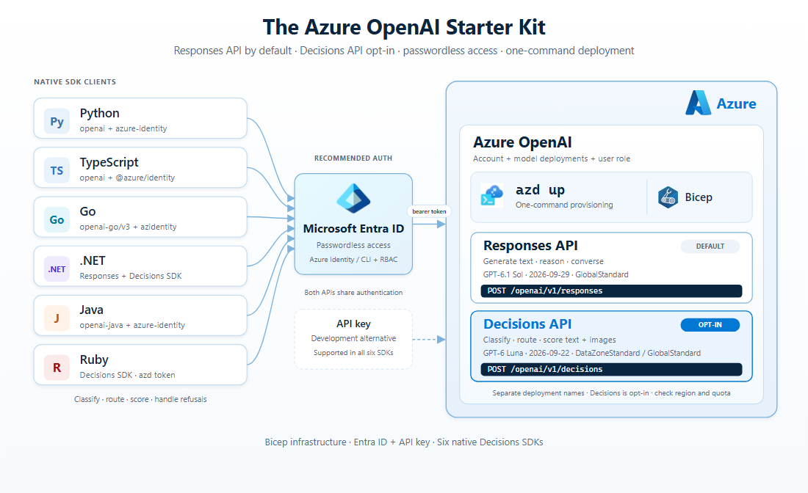

<!--
---
page_type: sample
languages:
- python
- typescript
- go
- csharp
- java
- ruby
products:
- azure-openai
- azure
urlFragment: azure-openai-starter
name: The Azure OpenAI Starter Kit
description: Deploy GPT-6.1 Sol with azd. Optionally add GPT-6 Luna for Decisions, with six-language samples and regional model discovery.
---
-->
# The Azure OpenAI Starter Kit

Deploy Azure OpenAI with one command. Use **GPT-6.1 Sol** with the **Responses API**,
and optionally add **GPT-6 Luna** for classification, routing, and scoring with the
**Decisions API**.

## Overview

| API | Use it for | Model deployment |
|---|---|---|
| **Responses API** | Generate text, reason, and have conversations | GPT-6.1 Sol (default) |
| **Decisions API** | Classify, route, and score text or images | GPT-6 Luna (opt-in) |

Use [Responses](#quick-start-responses) when you want generated text, and
[Decisions](#quick-start-decisions) when you want structured probabilities, choices,
and scores instead of prose.

## Architecture



[SVG source](./images/architecture.svg). Bicep provisions an Azure OpenAI account,
the Responses model deployment, and the deploying user's Cognitive Services User
role assignment. The Decisions deployment is **opt-in**, not an additional
resource provisioned by default. Both APIs support passwordless access with
Microsoft Entra ID or an explicit API-key alternative. The Ruby examples obtain
an Entra token from your Azure Developer CLI (`azd`) login.

## Prerequisites

- [Azure subscription](https://azure.microsoft.com/pricing/purchase-options/azure-account)
- [Azure CLI](https://learn.microsoft.com/cli/azure/install-azure-cli), signed in with `az login`
- [Azure Developer CLI](https://learn.microsoft.com/azure/developer/azure-developer-cli/install-azd),
  signed in with `azd auth login`
- [PowerShell 7 (`pwsh`)](https://learn.microsoft.com/powershell/scripting/install/installing-powershell-on-windows)
  on Windows, for the azd preprovision validation hook
- A supported region and sufficient quota for the model and deployment SKU.
  Bicep defaults to `eastus` and allows only regions that support both GPT-6.1 Sol and
  the Decisions API (East US 2 is excluded); check the current region table before
  changing it.
- The runtime for your sample: Python 3.10+, Node.js 24+, Go 1.26+,
  .NET 10, Java 21 with Maven, or Ruby 3.3+ with Bundler

See [client setup](./CLIENT_README.md) for dependency versions and commands.

## Quick start: Responses

```bash
az login
azd auth login
azd up
```

This deploys GPT-6.1 Sol (`2026-09-29`) on `GlobalStandard`. The default capacity
is 10 thousand tokens per minute, subject to subscription quota. Configure it
with `azd env set AZURE_OPENAI_CAPACITY 10`.

Set the resource endpoint, then run a passwordless example:

```bash
export AZURE_OPENAI_ENDPOINT="$(azd env get-value AZURE_OPENAI_ENDPOINT)"
export AZURE_OPENAI_GPT_DEPLOYMENT_NAME="$(azd env get-value AZURE_OPENAI_GPT_DEPLOYMENT_NAME)"
python -m pip install -r src/python/requirements.txt
python src/python/responses_example_entra.py
```

PowerShell:

```powershell
$env:AZURE_OPENAI_ENDPOINT = azd env get-value AZURE_OPENAI_ENDPOINT
$env:AZURE_OPENAI_GPT_DEPLOYMENT_NAME = azd env get-value AZURE_OPENAI_GPT_DEPLOYMENT_NAME
python -m pip install -r src\python\requirements.txt
python src\python\responses_example_entra.py
```

Responses samples cover simple text, conversations, explicit error handling,
and reasoning-token usage. Optional settings:

| Environment variable | Default | Meaning |
|---|---|---|
| `AZURE_OPENAI_GPT_DEPLOYMENT_NAME` | `gpt-6.1-sol` | Your Responses deployment name |
| `AZURE_OPENAI_REASONING_EFFORT` | `medium` | `low`, `medium`, `high`, `xhigh`, or `max` |
| `AZURE_OPENAI_MAX_OUTPUT_TOKENS` | `16384` | Integer from 16 to 128000, including reasoning tokens |

These reasoning settings are **not** sent to the Decisions API.
For .NET Responses, supply the corresponding native `Clients:Responses`
configuration using the [appsettings example](./src/dotnet/appsettings.example.json)
or double-underscore environment keys. The OpenAI SDK's `AddResponsesClient`
handles binding; these examples no longer translate the common starter variables.

## Quick start: Decisions

The [Decisions API](https://learn.microsoft.com/azure/foundry/openai/how-to/decisions)
needs a **GPT-6 Luna** deployment, not Sol. Enable it as an opt-in deployment in the
same Azure OpenAI account:

```bash
azd auth login
azd env set AZURE_OPENAI_DEPLOY_DECISIONS true
# Only if Luna is unavailable as DataZoneStandard in your region:
# azd env set AZURE_OPENAI_DECISIONS_SKU GlobalStandard
azd up
```

By default, this adds GPT-6 Luna (`2026-09-22`) on `DataZoneStandard`, with its own
quota and billing; see [Decisions deployment](./CLIENT_README.md#decisions-deployment)
for regions, SKUs, and capacity. An existing Luna deployment works without
provisioning; configure it as described in [Configuration](./CLIENT_README.md#configuration).

From the repository root, set the endpoint and Luna deployment name, then run the text
and multimodal samples:

```bash
export AZURE_OPENAI_ENDPOINT="$(azd env get-value AZURE_OPENAI_ENDPOINT)"
export AZURE_OPENAI_DEPLOYMENT="$(azd env get-value AZURE_OPENAI_DEPLOYMENT)"
python -m pip install -r src/python/requirements.txt
python src/python/decisions_example.py
python src/python/decisions_multimodal_example.py
```

PowerShell:

```powershell
$env:AZURE_OPENAI_ENDPOINT = azd env get-value AZURE_OPENAI_ENDPOINT
$env:AZURE_OPENAI_DEPLOYMENT = azd env get-value AZURE_OPENAI_DEPLOYMENT
python -m pip install -r src\python\requirements.txt
python src\python\decisions_example.py
python src\python\decisions_multimodal_example.py
```

The text sample routes a support ticket. The multimodal sample assesses a public NASA
photo by default; pass your own HTTPS URL or image path as an argument
([Real-photo scenarios](./CLIENT_README.md#real-photo-scenarios)). Both use your
`azd auth login` identity by default; `AZURE_OPENAI_API_KEY` is an optional fallback.
For TypeScript, Go, Java, .NET, and Ruby, see the [client guide](./CLIENT_README.md).

## SDK baseline

These published OpenAI versions include the expanded Decisions GA types. Versions
were checked on **2026-10-23**, except .NET, which was checked on **2026-11-05**.

| SDK | Version used as the sample baseline |
|---|---|
| [Python](https://pypi.org/project/openai/3.37.0/) | `3.37.0` |
| [JavaScript / TypeScript](https://www.npmjs.com/package/openai/v/7.43.0) | `7.43.0` |
| [Go](https://pkg.go.dev/github.com/openai/openai-go/v3@v3.86.0) | `v3.86.0` |
| [Java](https://central.sonatype.com/artifact/com.openai/openai-java/4.91.0) | `4.91.0` |
| [Ruby](https://rubygems.org/gems/openai/versions/0.111.0) | `0.111.0` |
| [.NET](https://www.nuget.org/packages/OpenAI/2.15.0) | `2.15.0` (Responses and the experimental Decisions client) |

A newer SDK can require source changes and does not enable an Azure feature; see the
[Decisions API notes](./CLIENT_README.md#decisions-api-notes).

## Validation

```bash
# Infrastructure compilation and required-file checks; no resources are deployed.
bash validate.sh

# Or PowerShell:
pwsh -File validate.ps1

# Model-catalog unit tests only; no SDKs or cloud access required.
python -m unittest discover -s tests -p test_model_support.py -v

# After restoring all six languages' dependencies:
python -m unittest discover -s tests -v
```

The contract suite runs the real SDK clients against a local
HTTP server, checks payloads and deployment overrides, and exercises refusals,
HTTP failures and unusable responses. It does not prove Azure rollout or quota.
Live tests require an existing deployment and can incur charges:

- Responses: `AZURE_OPENAI_LIVE_TESTS=1` (requires its documented key and Entra setup).
- Decisions: `AZURE_OPENAI_DECISIONS_LIVE_TESTS=1` (uses Entra only, removes the API-key
  fallback, and runs text plus inline/HTTPS photo inputs for every selected language).

Set `AZURE_OPENAI_ENDPOINT` and `AZURE_OPENAI_DEPLOYMENT` for Decisions live tests.
Offline CI does not supply Azure credentials and cannot certify live service behavior.

## Cleanup

```bash
azd down
```

Review the resources selected for deletion. This removes this environment's
resource group, including its model deployments; it does not remove unrelated
deployments in a separately managed resource.
