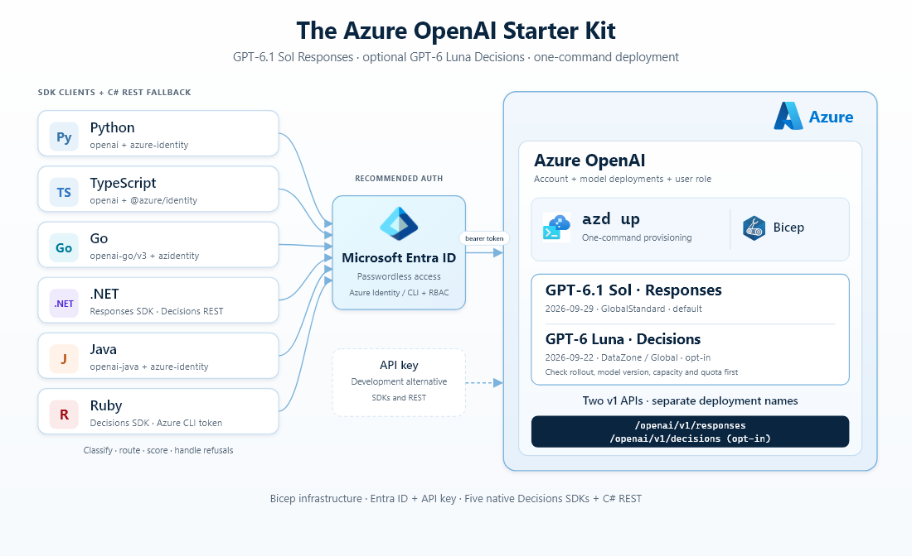

<!--
---
page_type: sample
languages:
- python
- typescript
- go
- csharp
- java
- ruby
products:
- azure-openai
- azure
urlFragment: azure-openai-starter
name: The Azure OpenAI Starter Kit
description: Deploy GPT-6.1 Sol with azd. Optionally add GPT-6 Luna for Decisions, with six-language samples and regional model discovery.
---
-->
# The Azure OpenAI Starter Kit

Deploy Azure OpenAI with one command. Use **GPT-6.1 Sol** with the Responses API,
or optionally add **GPT-6 Luna** for fast classification, routing, and scoring
with the Decisions API.

## Architecture



[SVG source](./images/architecture.svg). Bicep provisions an Azure OpenAI account,
the Responses model deployment, and the deploying user's Cognitive Services User
role assignment. The Decisions deployment is **opt-in**, not an additional
resource provisioned by default. All samples support API keys or passwordless
access; Ruby uses an Azure CLI token for its passwordless example.

## Prerequisites

- [Azure subscription](https://azure.microsoft.com/pricing/purchase-options/azure-account)
- [Azure CLI](https://learn.microsoft.com/cli/azure/install-azure-cli), signed in with `az login`
- [Azure Developer CLI](https://learn.microsoft.com/azure/developer/azure-developer-cli/install-azd),
  signed in with `azd auth login`
- [PowerShell 7 (`pwsh`)](https://learn.microsoft.com/powershell/scripting/install/installing-powershell-on-windows)
  on Windows, for the azd preprovision validation hook
- A supported region and sufficient quota for the model and deployment SKU.
  Bicep defaults to `eastus`; check the current region table before changing it.
- The runtime for your sample: Python 3.10+, Node.js 24+, Go 1.26+,
  .NET 10, Java 21 with Maven, or Ruby 3.3+ with Bundler

See [client setup](./CLIENT_README.md) for dependency versions and commands.

## Quick start: Responses

```bash
az login
azd auth login
azd up
```

This deploys GPT-6.1 Sol (`2026-09-29`) on `GlobalStandard`. The default capacity
is 10 thousand tokens per minute, subject to subscription quota. Configure it
with `azd env set AZURE_OPENAI_CAPACITY 10`.

Set the resource endpoint, then run a passwordless example:

```bash
export AZURE_OPENAI_ENDPOINT="$(azd env get-value AZURE_OPENAI_ENDPOINT)"
export AZURE_OPENAI_GPT_DEPLOYMENT_NAME="$(azd env get-value AZURE_OPENAI_GPT_DEPLOYMENT_NAME)"
cd src/python
python -m pip install -r requirements.txt
python responses_example_entra.py
```

PowerShell:

```powershell
$env:AZURE_OPENAI_ENDPOINT = azd env get-value AZURE_OPENAI_ENDPOINT
$env:AZURE_OPENAI_GPT_DEPLOYMENT_NAME = azd env get-value AZURE_OPENAI_GPT_DEPLOYMENT_NAME
Set-Location src\python
python -m pip install -r requirements.txt
python responses_example_entra.py
```

Responses samples cover simple text, conversations, explicit error handling,
and reasoning-token usage. Optional settings:

| Environment variable | Default | Meaning |
|---|---|---|
| `AZURE_OPENAI_GPT_DEPLOYMENT_NAME` | `gpt-6.1-sol` | Your Responses deployment name |
| `AZURE_OPENAI_REASONING_EFFORT` | `medium` | `low`, `medium`, `high`, `xhigh`, or `max` |
| `AZURE_OPENAI_MAX_OUTPUT_TOKENS` | `16384` | Integer from 16 to 128000, including reasoning tokens |

These reasoning settings are **not** sent to the Decisions API.

## Decisions: classify, route, and score

The [Azure OpenAI Decisions API](https://learn.microsoft.com/azure/foundry/openai/how-to/decisions)
uses a **GPT-6 Luna deployment**, not GPT-6.1 Sol. Its typed answers include
predicate probabilities, predefined choices, scores, and per-question refusals.
The samples batch a predicate, a choice with an `other` fallback, and a severity
score in one request. Every language uses the same scenarios and prints named
answers, option probabilities, confidence and token usage.

The fastest way to explore is the **Decision playground** in the Foundry portal:
open the GPT-6 Luna deployment, choose **Open in playground**, then **Decision
playground**. The examples below are for integrating that flow into an application.

### 1. Check region and model availability

```bash
python scripts/check-model-support.py --region eastus --model gpt-6-luna --sku DataZoneStandard
python scripts/check-model-support.py --region westus3 --model gpt-6-luna --sku DataZoneStandard --format json
```

The West US 3 command inspects Luna only; it does not validate this starter's
separate Sol deployment. Check **both** models and their respective SKUs before
choosing a nondefault region for the combined template.

The script uses read-only `az cognitiveservices model list` calls. It reports
model versions and deployment SKUs when Azure returns them, and distinguishes
catalog visibility from actual endpoint support. It does **not** deploy resources,
read keys, consume model tokens, or prove quota/capacity.

The Decisions documentation checked on **2026-10-23** excludes **East US 2** from
the rollout, even if GPT-6 Luna appears in that region's model catalog. Recheck the
[current rollout documentation](https://learn.microsoft.com/azure/foundry/openai/how-to/decisions)
and [regional model table](https://learn.microsoft.com/azure/foundry/foundry-models/concepts/models-sold-directly-by-azure-region-availability).
The azd preprovision check rejects `AZURE_OPENAI_DEPLOY_DECISIONS=true` with
`AZURE_LOCATION=eastus2` before creating resources.
Use `--all-regions` only when you intend to query every subscription-visible
location; this can take several minutes.

### 2. Optionally provision a Decisions deployment

Choose a region supported by **both** deployments before provisioning.
The default is `eastus`. Prefer `DataZoneStandard` for Luna when available in
your region and subscription; use `GlobalStandard` if that is the appropriate
available SKU. Neither SKU guarantees a particular latency.

```bash
azd env set AZURE_LOCATION eastus
azd env set AZURE_OPENAI_DEPLOY_DECISIONS true
azd env set AZURE_OPENAI_DECISIONS_MODEL_VERSION 2026-09-22
azd env set AZURE_OPENAI_DECISIONS_SKU DataZoneStandard
azd env set AZURE_OPENAI_DECISIONS_CAPACITY 10
azd up
```

GPT-6 Luna (`2026-09-22`) is listed in the
[public Azure model catalog](https://learn.microsoft.com/azure/foundry/foundry-models/concepts/models-sold-directly-by-azure).
The optional deployment defaults to `DataZoneStandard` and has separate quota
and billing. Set `AZURE_OPENAI_DECISIONS_SKU=GlobalStandard` before provisioning
to select that alternative. See the
[deployment-type guidance](https://learn.microsoft.com/azure/foundry/foundry-models/concepts/deployment-types)
and live model catalog; do not assume every model/SKU is available in every region.
If you already have a Luna deployment, skip this step and set its name directly.
Disabling the option in a later incremental deployment does not necessarily
delete an existing Azure deployment; manage its lifecycle explicitly.

### 3. Run a sample

```bash
export AZURE_OPENAI_ENDPOINT="$(azd env get-value AZURE_OPENAI_ENDPOINT)"
export AZURE_OPENAI_DEPLOYMENT="$(azd env get-value AZURE_OPENAI_DEPLOYMENT)"
python src/python/decisions_example.py
```

PowerShell:

```powershell
$env:AZURE_OPENAI_ENDPOINT = azd env get-value AZURE_OPENAI_ENDPOINT
$env:AZURE_OPENAI_DEPLOYMENT = azd env get-value AZURE_OPENAI_DEPLOYMENT
python src\python\decisions_example.py
```

`AZURE_OPENAI_DEPLOYMENT` is your **Azure deployment name**, not a model selector;
it must refer to a deployment of `gpt-6-luna`, the only supported Decisions model.
Use the same two-variable configuration in every language. [.env.example](./.env.example)
documents the shape; export its values into your shell before running a sample.
The examples build the SDK base URL as `https://{resource}.openai.azure.com/openai/v1/`.

Leave `AZURE_OPENAI_API_KEY` unset for the default passwordless flow using
`DefaultAzureCredential` and a bearer token provider. Ruby uses an Azure CLI
Entra token because there is no Azure Identity Ruby implementation in this starter.
Set an API key only for the explicit fallback; never commit credentials.

| Language | Decisions implementation | Run from its sample directory |
|---|---|---|
| [Python](./src/python/decisions_example.py) | Native OpenAI SDK | `python decisions_example.py` |
| [TypeScript / JavaScript](./src/typescript/decisions_example.ts) | Native OpenAI SDK | `npm run decisions` |
| [Go](./src/go/decisions_example/main.go) | Native OpenAI SDK | `go run .` |
| [Java](./src/java/src/main/java/com/azure/openai/starter/DecisionsExample.java) | Native OpenAI SDK | `mvn compile exec:java -Dexec.mainClass=com.azure.openai.starter.DecisionsExample` |
| [Ruby](./src/ruby/decisions_example.rb) | Native OpenAI SDK | `bundle exec ruby decisions_example.rb` |
| [.NET / C#](./src/dotnet/decisions_example.cs) | `HttpClient` REST fallback | `dotnet run decisions_example.cs` |

**Documentation authors:** [docs/decisions.md](./docs/decisions.md) provides
Microsoft Learn-style language tabs that include these runnable sources directly.
It separates current Azure-documented behavior from OpenAI SDK capabilities.
The .NET fallback is intentional: OpenAI 2.14.0 has no native typed Decisions client.

### 4. Try a real photo, inline or by HTTPS URL

Each sample accepts the same `--image PATH_OR_HTTPS_URL` option. It changes the
three batched questions to visible damage, object category with an `other`
fallback, and damage severity. The local file is encoded as a data URL; a public
HTTPS URL is passed to Azure for fetching. There is no client-side URL download.

From the repository root, for example:

```bash
python src/python/decisions_example.py --image images/decisions-photo.png
python src/python/decisions_example.py --image https://raw.githubusercontent.com/scikit-image/scikit-image/v0.25.2/skimage/data/astronaut.png
```

The included image is a real NASA photograph released into the public domain;
see [image attribution](./images/decisions-photo.md). It is a transport example,
not evidence that the photo depicts a damaged object or a fixed model-quality
benchmark. You can substitute a photo relevant to your own application.

## Azure behavior and latency notes

- Decisions is non-streaming: each request returns a single JSON response.
- These examples send **uncompressed JSON**. Do not enable request compression
  for this sample flow.
- No example depends on prompt caching. Cache counters can be **zero**; usage
  reports input totals and any returned cache-read/write breakdowns.
- Missing or incorrect deployment names can produce Azure-style **400 or 404**
  errors. Handle non-success HTTP responses generically instead of matching
  OpenAI-specific error text.
- Handle safety refusals explicitly. For ambiguous classifications, use the
  `other` category and probability thresholds; do not expect ambiguity to
  produce a refusal.
- Image formats: **PNG, JPEG, WebP and GIF**; at most **128 images** and **32 MB
  combined** per request. These samples send one image and enforce the file limit.
- Review [Azure OpenAI pricing](https://azure.microsoft.com/pricing/details/azure-openai/)
  for the current input, cache-read and cache-write charges. The
  [OpenAI Decisions guide](https://developers.openai.com/api/docs/guides/decisions)
  states that Decision output tokens are not charged; confirm the applicable
  Azure price and deployment tier rather than copying OpenAI dollar rates.
- Create one client and reuse it for additional batches, keeping HTTP connections
  warm. Deploy near your application and batch related questions instead of
  making a new connection/request for every question.

JSON input, conversation/tool history, explicit caching controls and Live
integration are deliberately **not demonstrated** here. Those advanced payloads
must be validated against the target Azure deployment before adding them; SDK
type availability alone is not a service-compatibility test.

## SDK baseline

These published OpenAI versions include the expanded Decisions GA types, except
.NET, which uses REST for Decisions. Versions were checked on **2026-10-23**.

| SDK | Version used as the sample baseline |
|---|---|
| [Python](https://pypi.org/project/openai/3.37.0/) | `3.37.0` |
| [JavaScript / TypeScript](https://www.npmjs.com/package/openai/v/7.43.0) | `7.43.0` |
| [Go](https://pkg.go.dev/github.com/openai/openai-go/v3@v3.86.0) | `v3.86.0` |
| [Java](https://central.sonatype.com/artifact/com.openai/openai-java/4.91.0) | `4.91.0` |
| [Ruby](https://rubygems.org/gems/openai/versions/0.111.0) | `0.111.0` |
| [.NET](https://www.nuget.org/packages/OpenAI/2.14.0) | `2.14.0` for Responses; REST for Decisions |

The non-.NET release notes call out type changes to message inputs and structured
instruction parts. Updating an existing application can require source changes.
The Learn article's older minimums (Python 3.26.0 and JavaScript 7.30.0) are valid
for its basic text examples; this starter deliberately pins the newer GA-type releases.
Model availability, service-feature availability, and SDK type availability are
different checks; installing a newer SDK does not enable an Azure feature.

## Validation

```bash
# Infrastructure compilation and required-file checks; no resources are deployed.
bash validate.sh

# Or PowerShell:
pwsh -File validate.ps1

# Model-catalog unit tests only; no SDKs or cloud access required.
python -m unittest discover -s tests -p test_model_support.py -v

# After restoring all six languages' dependencies:
python -m unittest discover -s tests -v
```

The contract suite runs real SDK clients and the .NET REST client against a local
HTTP server, checks payloads and deployment overrides, and exercises refusals,
HTTP failures, and malformed responses. It does not prove Azure rollout or quota.
Live tests require an existing deployment and can incur charges:

- Responses: `AZURE_OPENAI_LIVE_TESTS=1` (requires its documented key and Entra setup).
- Decisions: `AZURE_OPENAI_DECISIONS_LIVE_TESTS=1` (uses Entra only, removes the API-key
  fallback, and runs text plus inline/HTTPS photo inputs for every selected language).

Set `AZURE_OPENAI_ENDPOINT` and `AZURE_OPENAI_DEPLOYMENT` for Decisions live tests.
Offline CI does not supply Azure credentials and cannot certify live service behavior.

## Cleanup

```bash
azd down
```

Review the resources selected for deletion. This removes this environment's
resource group, including its model deployments; it does not remove unrelated
deployments in a separately managed resource.
